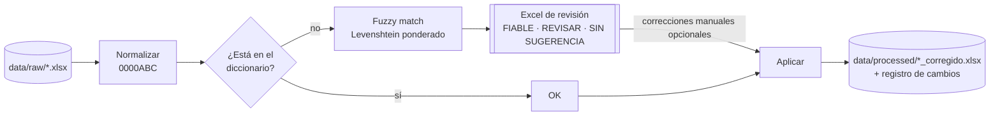

# 🚌 transit-data-cleaner

[](https://github.com/alsejofre/transit-data-cleaner/actions/workflows/tests.yml)


[](LICENSE)

Pipelines en Python para **limpiar y corregir automáticamente los datos de campo
de estudios de movilidad**: matrículas de autobús, calcas (números de flota) y
lugares de origen/destino que los encuestadores transcriben a mano en Excel.

> *Python pipelines that clean hand-typed field data from public-transport studies
> (bus licence plates, fleet numbers, survey origins/destinations) by matching it
> against reference dictionaries with a typo-aware fuzzy matcher.*

---

## El problema

En aforos, encuestas a bordo y auditorías *mystery shopper*, cada inspector apunta la
matrícula del autobús a mano. El resultado son miles de filas así:

| Lo que llega          | Lo que debería ser |
|-----------------------|--------------------|
| `O791 ftr`            | `0791FTR`          |
| `5142GKP`             | `1542GKP`          |
| `FTR-791`             | `0791FTR`          |
| `2335`                | `3517GKP 2333`     |
| `3517GKN`             | `3517GKP 2333`     |

Corregirlo a mano lleva horas y se cuelan errores. Estos scripts lo hacen en segundos,
dejan **solo los casos dudosos** para revisión humana y generan un Excel corregido
**sin tocar el formato ni el resto de columnas** del original.

## Módulos

| Módulo | Qué corrige | Diccionario de referencia |
|---|---|---|
| [`ControlParada`](scripts/ControlParada) | Columna `MATRICULA` | Lista fija de la flota (`config/matriculas.txt`) |
| [`Mistery`](scripts/Mistery) | Columna `MATRICULA_CALCA` (matrícula, calca o ambas) | Flota + diccionario de calcas **deducido de los datos** |
| [`Matriculas`](scripts/Matriculas) | Columna `MATRICULA` de aforos | Diccionario **deducido de los datos** (letras más frecuentes por número) |
| [`Barrios`](scripts/Barrios) | Columnas `ORIGEN` / `DESTINO` de encuestas | Agrupación de variantes + corrección manual |

## Cómo funciona



**Puntos clave del diseño**

- **Distancia de edición ponderada**: una variante de Levenshtein (con transposiciones,
  tipo Damerau) en la que las confusiones típicas al transcribir cuestan menos
  (`O↔0`, `S↔5`, `B↔8`, `Z↔2`, `I/L↔1`, `M↔N`…). Así `O791FTR` → `0791FTR` es un
  match casi seguro, y `9791FTR` no.
- **Persona en el bucle**: el paso 1 nunca modifica nada; genera un Excel de revisión
  con código de colores. Lo que no te convenza lo sobrescribes en la columna
  `CORRECTA` y el paso 2 lo respeta.
- **Diccionarios deducidos de los datos** (Mistery, Matriculas): la calca de cada
  autobús se infiere por frecuencia y confianza, y se detectan empates y calcas
  asignadas a dos matrículas a la vez.
- **El Excel original se respeta**: se edita con `openpyxl` celda a celda, así que se
  conservan estilos, anchos, otras hojas y columnas. Cada cambio queda registrado en
  un Excel aparte.
- **Privacidad**: `data/` y el diccionario real de la flota están en `.gitignore`.
  El repo solo incluye datos **sintéticos**.

## Inicio rápido

```bash
git clone https://github.com/alsejofre/transit-data-cleaner.git
cd transit-data-cleaner
python -m venv .venv
.venv\Scripts\activate            # Windows  (Linux/macOS: source .venv/bin/activate)
pip install -r requirements.txt

# Datos de ejemplo sintéticos en data/raw
python examples/generar_datos_ejemplo.py

# Paso 1: detectar y proponer correcciones -> data/processed/control_parada_revision.xlsx
python scripts/ControlParada/run_pipeline.py

# Paso 2: aplicar -> data/processed/Matricules_Control_Parada_corregido.xlsx
python scripts/ControlParada/run_pipeline.py --corregir
```

Todos los pipelines aceptan `--todo` (hacer los dos pasos seguidos) y `--corregir`
(solo aplicar). Cada módulo tiene su propio README con el detalle.

### Usar tu propia flota

```bash
copy config\matriculas.example.txt config\matriculas.txt   # Linux/macOS: cp
```

Edita `config/matriculas.txt` con una matrícula por línea. Este archivo no se sube a git.

## Estructura

```
transit-data-cleaner/
├── config/
│   └── matriculas.example.txt   # diccionario ficticio (el real: matriculas.txt, ignorado)
├── data/
│   ├── raw/                     # Excels de entrada (ignorados por git)
│   └── processed/               # resultados (ignorados por git)
├── examples/
│   └── generar_datos_ejemplo.py # genera datos sintéticos para los 4 pipelines
├── scripts/
│   ├── ControlParada/           # matrícula vs. flota conocida
│   ├── Mistery/                 # matrícula + calca, con diccionario de calcas inferido
│   ├── Matriculas/              # matrícula sin flota conocida (diccionario inferido)
│   └── Barrios/                 # normalización de origen/destino
├── tests/                       # pytest: unitarios + punta a punta
└── .github/workflows/tests.yml  # CI en Ubuntu y Windows
```

## Tests

```bash
pip install -r requirements-dev.txt
pytest
```

Los tests de punta a punta copian el proyecto a una carpeta temporal, generan datos
sintéticos, ejecutan cada pipeline y comprueban que el Excel de salida mantiene
intactas las demás columnas y el formato. Se ejecutan en cada push con GitHub Actions
(Ubuntu y Windows).

## Tecnologías

Python · pandas · openpyxl · pytest · GitHub Actions

## Autor

**Jofre** — [@alsejofre](https://github.com/alsejofre)
Técnico de sistemas y datos. Estas herramientas nacen de automatizar el procesamiento
de datos de campo en estudios de movilidad y transporte público.

Licencia [MIT](LICENSE).
